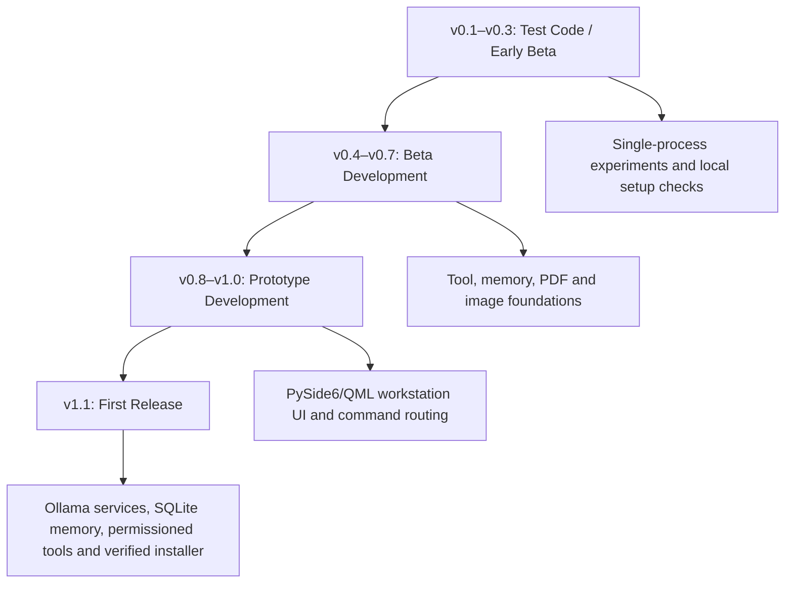

# ARLEN NEXUS v1.1

<div align="center">

## Adaptive Responsive Local Executive Neural-Assistant

### Neural Execution and Experience Unified System

**A private offline-first AI workstation for Windows**

</div>

---

# Vision

ARLEN NEXUS is designed to become a personal AI operating companion, not just a chatbot.

It combines:

- Local AI intelligence
- Personal memory
- Document understanding
- Image intelligence
- File assistance
- System utilities
- Futuristic desktop experience

Core philosophy:

```text
Ollama         = AI Brain
Python Tools   = AI Hands
SQLite Memory  = Local Memory
Premium UI     = AI Workstation
```

---

# Current Status

## Ready Environment

Current development/test environment:

- ✅ Python 3.11.9
- ✅ Ollama 0.32.15
- ✅ Qwen2.5:3B Text Model
- ✅ Qwen2.5VL:3B Vision Model
- ✅ FFmpeg
- ✅ Image-processing Python stack

Primary target:

- Windows desktop
- Offline-first operation
- Low-resource design
- 4GB RAM class PC support for the lightweight/core workflow
- 8GB+ RAM recommended for smoother Vision workloads

ARLEN should avoid keeping both local models loaded at the same time on low-memory systems. The normal text model and vision model should be loaded only when required.

---

# PC Requirements & Official Setup Links

> This section documents the current development/manual environment. The final user-facing goal is still a simple `ARLEN-NEXUS-Setup.exe` experience where ARLEN detects and configures the PC automatically with as little manual setup as possible.

## 1. Python

Current tested version: **Python 3.11.9**

Official links:

- Python 3.11.9: https://www.python.org/downloads/release/python-3119/
- Python downloads: https://www.python.org/downloads/windows/

Python is used for the ARLEN backend, tools, memory, document processing, image processing and Windows integration.

## 2. Ollama

Current tested version: **Ollama 0.32.15**

Official links:

- Windows download: https://ollama.com/download/windows
- Ollama website: https://ollama.com/

Check installation:

```cmd
ollama --version
```

## 3. Text Brain — Qwen2.5:3B

Used for:

- Offline chat
- Command understanding
- Reasoning
- Tool planning
- Normal assistant tasks

Official model page:

- https://ollama.com/library/qwen2.5

Install:

```cmd
ollama pull qwen2.5:3b
```

Test:

```cmd
ollama run qwen2.5:3b
```

## 4. Vision Brain — Qwen2.5VL:3B

Used for:

- Image understanding
- Screenshot analysis
- Document-image understanding
- Smart image-editing suggestions

Official model page:

- https://ollama.com/library/qwen2.5vl

Install:

```cmd
ollama pull qwen2.5vl:3b
```

Test:

```cmd
ollama run qwen2.5vl:3b
```

Recommended:

- Core/normal ARLEN use: 4GB RAM target
- Vision workloads: 8GB+ RAM recommended for a smoother experience

## 5. FFmpeg

Used for future/local media-processing features.

Official links:

- https://ffmpeg.org/download.html
- Windows build information: https://ffmpeg.org/download.html#build-windows

Check:

```cmd
ffmpeg -version
```

---

# Python Dependency Stack

The current ARLEN V1 development stack uses lightweight Python libraries instead of separate large desktop applications whenever possible.

## Core / System

### psutil

CPU, RAM, disk, battery and process/system information.

- https://pypi.org/project/psutil/

```cmd
pip install psutil
```

### requests

Local Ollama HTTP/API communication and other controlled HTTP tasks.

- https://pypi.org/project/requests/

```cmd
pip install requests
```

### SQLite

Python includes `sqlite3` by default. No separate installation is normally required.

Test:

```cmd
python -c "import sqlite3; print('SQLite OK')"
```

---

# PDF Dependencies

### PyMuPDF

PDF reading, extraction, rendering and document processing.

- https://pypi.org/project/PyMuPDF/

```cmd
pip install pymupdf
```

### pypdf

PDF merge, split and page-level operations.

- https://pypi.org/project/pypdf/

```cmd
pip install pypdf
```

---

# Image Dependencies

### Pillow

Basic image loading, resizing, conversion and enhancement.

- https://pypi.org/project/pillow/

```cmd
pip install pillow
```

### OpenCV

Sharpness, dehaze-style processing, blur, contrast and advanced local image operations.

- https://pypi.org/project/opencv-python/

```cmd
pip install opencv-python
```

### NumPy

Image/numerical processing dependency.

- https://pypi.org/project/numpy/

```cmd
pip install numpy
```

### piexif

Image EXIF/metadata handling.

- https://pypi.org/project/piexif/

```cmd
pip install piexif
```

### rembg

Optional background-removal dependency. It is installed/available in the development environment but background removal is **not** a default ARLEN V1 workflow; background blur and enhancement are preferred.

- https://pypi.org/project/rembg/

```cmd
pip install rembg
```

---

# UI Dependency

### PySide6

Planned main Windows desktop UI framework for ARLEN NEXUS.

Used for:

- Main desktop window
- Panels
- Command Center
- Theme engine
- Animated sphere/background system
- Quick Tools

Official links:

- https://pypi.org/project/PySide6/
- https://doc.qt.io/qtforpython-6/

Install:

```cmd
pip install PySide6
```

---

# Optional OCR

OCR is **not required to start ARLEN V1 development**.

Normal digital PDFs can be processed with PyMuPDF/pypdf, while Qwen2.5VL can assist with screenshots and image understanding.

OCR becomes useful for:

- Scanned PDFs
- Photos of documents
- Printed text extraction
- Image-to-text workflows

Possible future option:

### Tesseract OCR

- Official project: https://github.com/tesseract-ocr/tesseract
- Python wrapper: https://pypi.org/project/pytesseract/

OCR remains optional until the scanned-document workflow is implemented and tested.

---

# Quick Development Install Command

For the Python-side V1 stack:

```cmd
pip install psutil requests pymupdf pypdf pillow opencv-python numpy piexif rembg PySide6
```

Environment check example:

```cmd
python -c "import psutil, requests, fitz, pypdf, PIL, cv2, numpy, piexif, sqlite3, PySide6; print('ARLEN V1 Environment Ready')"
```

---

# Final Installer Goal

The final ARLEN NEXUS user experience should be:

```text
Download
   ↓
ARLEN-NEXUS-Setup.exe
   ↓
Install
   ↓
Automatic System Detection
   ↓
Automatic Configuration
   ↓
ARLEN Ready
```

The installer/first-launch setup should detect:

- Existing Ollama installation
- Installed Qwen models
- FFmpeg
- Available browsers
- Installed applications
- ARLEN-supported tools
- Hardware/RAM capability

The user should not need to manually build folders, edit code or configure Python packages for the final release.

---

# V1 Feature Scope

## AI Assistant

- Offline chat
- Local AI reasoning
- Context understanding
- Basic memory
- User preferences

## Smart Setup

ARLEN automatically detects:

- Python/runtime environment
- Ollama
- AI models
- FFmpeg
- Installed applications
- Browsers
- Available tools

---

# Intelligence Modules

## PDF Intelligence

- Read PDF
- Summarize
- Explain documents
- Search text
- Extract information
- Merge/Split pages
- Rotate pages
- Add watermark

## Image Intelligence

- Image analysis
- Smart suggestions
- Sharpness improvement
- Texture enhancement
- Light correction
- Contrast adjustment
- Color correction
- Resize/Crop
- Format conversion
- Background blur suggestion

## Vision System

V1 includes lightweight smart-vision capabilities for practical image understanding.

Advanced Vision Pro will be considered only after the stable V1 base is complete.

---

# PC Assistant

ARLEN can help with:

- Open Chrome
- Open Brave
- Open VS Code
- Launch installed applications
- Find files
- Open documents
- Search useful documents/news/information through a browser
- Safe ARLEN/system refresh utilities

---

# Interface System

Default Theme:

## Aurora AI

Features:

- Animated AI Sphere
- Dynamic background
- Dark glass interface
- Theme switching
- Command Center
- Left Quick Tools panel
- Compact battery/sound/brightness controls
- UI sound effects only — no AI voice system

---

# Version History

| Version | Focus |
|---|---|
| v0.1 | Test Code / Early Beta — foundation |
| v0.2 | Test Code / Early Beta — desktop architecture |
| v0.3 | Test Code / Early Beta — local AI setup |
| v0.4 | Beta Development — tool architecture |
| v0.5 | Beta Development — memory system |
| v0.6 | Beta Development — document intelligence |
| v0.7 | Beta Development — image intelligence |
| v0.8 | Prototype Development — futuristic UI |
| v0.9 | Prototype Development — theme and sound system |
| v1.0 | Prototype Development — workstation interface |
| v1.1 | **First Release** — stable smart local workstation |

---

# Not Included in V1

- Voice assistant
- Whisper/TTS
- Plugin system
- Personal knowledge base
- Messenger automation
- Social automation
- Full PC takeover
- Deep browser automation

These are not current priorities. Expansion will be considered only after a stable V1 release.

---

# Development Roadmap

1. Backend Core
2. Ollama Integration
3. Memory System
4. Tool Manager
5. System Scanner
6. PDF Module
7. Image + Smart Vision Module
8. File Assistant
9. System Tools / Safe Refresh
10. Premium UI
11. Windows EXE + Installer
12. Stability Testing

---

# Goal

Build a private AI workstation that is:

- Local
- Fast
- Reliable
- Intelligent
- Low-resource aware
- Easy to install
- Expandable after V1 stability

**ARLEN NEXUS — Your personal AI workstation.**

---

# V1.1 Development Implementation

The current development branch now includes the first V1.1 foundations:

- Ollama chat adapter for `qwen2.5:3b`
- Ollama vision adapter for `qwen2.5vl:3b`
- bounded SQLite conversation memory
- real environment/model diagnostics
- 4 GB Low Resource mode
- responsive Theme 9 / Aurora AI dashboard based on the owner-approved demo
- centre-out animated core splash; the core image itself does not continuously rotate
- removable custom core/background and Aurora reset
- local calculator, unit converter, notes, screenshot and clipboard foundations
- local file metadata index, real filename search, organization preview, PIN-approved Downloads grouping, undo, Open and Reveal

V1.1 is the first release line. Its installer is published only after Windows build, QML lint, screen-size, packaged-launch and silent-install checks pass.

Detailed UI mapping, responsive breakpoints, historical bugs, fixes, benefits and remaining limitations are consolidated below so this README remains the single project guide.

## Ownership and AI assistance

ARLEN NEXUS was conceived, named, planned, directed, configured and tested by **Jubaer Hossain**. The full product name, logo direction, system structure and setup decisions come from Jubaer's plan. AI-assisted engineering helped implement and document the plan.

> Used correctly, AI makes human work easier, saves time and helps turn a clear plan into a working system while human judgment and ownership remain in control.

---

# V1.1 First Release Guide

## Click to open

- [Download and install](#download-for-windows)
- [PC requirements](#pc-requirements)
- [Working capabilities](#what-v11-can-do)
- [Interface and responsive rules](#aurora-ai-interface-map)
- [Version history and fixed bugs](#historical-problems-fixed-for-v11)
- [Button-to-backend flow](#what-happens-after-each-button-click)
- [Safety, privacy and limitations](#safety-and-privacy)

<details open>
<summary><strong>Download ARLEN NEXUS V1.1</strong></summary>

## Download for Windows

[**Download ARLEN NEXUS V1.1 Setup for Windows**](https://github.com/arlenray0113-cyber/ARLEN-NEXUS-PRIVATE/releases/download/v1.1.0/ARLEN-NEXUS-Setup-v1.1.0.exe)

This is the permanent private GitHub Release link. GitHub may ask the repository owner to sign in. Development or temporary Actions artifacts are intentionally not linked because those links expire.

</details>

<details>
<summary><strong>PC requirements and installation</strong></summary>

## PC requirements

| Profile | Minimum | Recommended |
|---|---|---|
| Operating system | Windows 10 64-bit | Windows 11 64-bit |
| Memory | 4 GB RAM with Low Resource mode | 8 GB or more |
| Free application space | 2 GB | 4 GB |
| Local AI runtime | Ollama installed separately | Current Ollama release |
| Text model | `qwen2.5:3b` | `qwen2.5:3b` |
| Vision model | Optional on 4 GB PCs | `qwen2.5vl:3b` |

The final installer includes the desktop application and its Python/Qt runtime. End users do not need to install Python, VS Code or Git to run ARLEN NEXUS. Ollama and local AI models remain separate because model downloads are large and hardware-dependent.

## First installation

1. Download the V1.1 Setup EXE from the release link above.
2. Open it and complete the per-user installation; administrator access is not normally required.
3. Open ARLEN NEXUS and use AI Setup to check Ollama and the installed models.
4. On a 4 GB PC, keep Low Resource mode enabled and use the text model alone when vision is not needed.

</details>

<details>
<summary><strong>All working capabilities</strong></summary>

## What V1.1 can do

| Workspace | Working behavior |
|---|---|
| Local Chat | Talks through local Ollama using `qwen2.5:3b`; reports an honest setup error when Ollama/model is missing |
| Local Memory | Saves bounded conversation history and user settings in upgrade-safe SQLite storage |
| Vision | Sends a selected image to `qwen2.5vl:3b` when that optional model is installed |
| Calculator | Safe arithmetic and scientific functions without unrestricted Python `eval` |
| Unit Converter | Local length, weight, temperature and storage conversion |
| Notes | Local UTF-8 Bangla/English note editing and Save As |
| Screenshot | Captures the primary Windows display to a selected local path |
| Clipboard | Reads or replaces the local text clipboard |
| File Search | Searches a bounded metadata index of common user folders and opens/reveals selected results |
| Smart Organization | Previews files directly inside Downloads, requires the owner PIN before moving them into `ARLEN Organized`, and supports one-level undo |
| Image Studio | Non-destructive light, contrast, saturation, sharpness/texture, crop, resize and export-copy foundations |
| PDF Studio | PDF reading and page-tool foundation; the interface must only advertise operations connected to tested handlers |
| System Dashboard | Shows real CPU, RAM, disk, battery, network, environment and AI readiness where available |
| Themes and Core | Ten themes, four core animation styles, custom visual import, remove and Aurora reset |

</details>

<details>
<summary><strong>Interface map and responsive screen rules</strong></summary>

## Aurora AI interface map

| Control | Interface opened |
|---|---|
| Dashboard | Responsive Aurora home with system overview, animated core, Command Center and AI status |
| Calculator / Scientific | Basic and scientific calculator workspace |
| Unit Converter | Category-based converter |
| PDF Tools | Local PDF workspace |
| Image Tools | Local image analysis and non-destructive editing workspace with examples |
| File Manager | Search, recent files, safe organization preview, apply and undo |
| Note Pad | Local note editor |
| Screenshot | Screen capture workspace |
| Clipboard | Text clipboard workspace |
| System Info | Device, runtime and ownership information |
| Settings | PIN, AI diagnostics, Low Resource mode, themes, custom core remove/reset and update safety |
| Top command field | Unified local chat and recognized safe-command router |

## Responsive screen policy

| Available width | Layout |
|---|---|
| 1450 px or more | Full navigation and three-column Aurora dashboard |
| 1100–1449 px | Narrow navigation and compact three-column dashboard |
| 900–1099 px | Icon navigation and single-column scrolling dashboard |
| Below 900 px | Not supported; the app enforces a 900×680 minimum |

The automated Windows gate renders and checks 1366×768 and 1920×1080 checkpoints. Release review also covers maximized/restored layouts, common Windows scaling, long labels, empty data and error messages.

</details>

<details>
<summary><strong>Version bugs fixed and release tests</strong></summary>

## Historical problems fixed for V1.1

| Earlier problem | V1.1 correction |
|---|---|
| A model folder could be reported as a ready AI brain | Real Ollama health and `/api/tags` model discovery |
| Home and Chat used separate message state | One SQLite-backed conversation source |
| Chat depended on a manually copied GGUF file | Local Ollama adapter for `qwen2.5:3b` |
| Vision readiness was guessed from folders | Real `qwen2.5vl:3b` discovery and selected-image payload |
| A custom sphere overwrote one cached filename | Unique visual filenames with Remove Custom Core and Reset Aurora |
| The entire sphere rotated continuously | Static core artwork with pulse, orbital rings and centre-out particle splash |
| Common laptop widths clipped the right rail | Responsive allocation and narrow-screen scrolling fallback |
| Voice controls implied an unavailable feature | Voice removed from the first-release scope |
| Chat history disappeared | Bounded WAL-mode SQLite history |
| File Manager was decorative | Real bounded search, Open, Reveal, organization preview, PIN approval and undo |
| Tools could look ready without a connected implementation | Status and errors now report unavailable dependencies honestly |

## Verified release gates

- Python source compilation
- 28 automated backend/service regression tests
- QML syntax validation
- 1366×768 responsive render
- 1920×1080 responsive render
- 1366×768 render of Calculator, Converter, PDF, Image, File Manager, Notes, Screenshot, Clipboard, System Info and Settings workspaces
- Windows PyInstaller EXE creation
- executable existence check
- final installer launch and upgrade test before the Release link is published

</details>

<details>
<summary><strong>Safety, privacy and current limitations</strong></summary>

## Safety and privacy

- Chat, memory, notes and metadata stay local unless the owner explicitly opens an external service.
- File discovery records filenames, paths, types, sizes and modified times; it does not silently upload file contents.
- Smart organization never auto-deletes files and does not move anything before preview plus owner PIN approval.
- User data is stored under `%LOCALAPPDATA%\ARLEN NEXUS\UserData` and is preserved across application upgrades.
- Missing model, GPU telemetry or tool support is shown as unavailable; ARLEN does not invent readiness or sensor values.

## First-release limitations

- Voice, Whisper and TTS are not included in V1.1.
- Ollama and the Qwen models are separate installations.
- Image prompt editing maps supported words to deterministic local filters; it is not a generative image model.
- GPU temperature is omitted when a reliable provider is unavailable.
- Full PC takeover, mouse/keyboard automation, background monitoring, social automation and silent deletion remain disabled.

</details>

<details>
<summary><strong>Source structure and backend evolution</strong></summary>

## Source structure

- `main.py` — Qt startup, bundled UI font and automated screenshot capture.
- `backend.py` — settings, commands, telemetry, migrations and tool routing.
- `v1_services.py` — SQLite, Ollama, discovery and local launching services.
- `qml/Main.qml` — responsive Aurora AI interface and animations.
- `tests/` — core, safety and service regression tests.
- `ARLEN_NEXUS.spec` — Windows portable application build.
- `installer/ARLEN-NEXUS.iss` — fixed-AppId per-user installer definition.
- `.github/workflows/v1-development-verify.yml` — Windows validation and build gate.

## How the backend evolved



| Version stage | Backend behavior |
|---|---|
| v0.1–v0.3 — Test Code / Early Beta | Tested Python desktop startup, offline-first concept and local model setup. State and capabilities were mostly experimental. |
| v0.4–v0.7 — Beta Development | Added tool routing, early memory, document/image operations and the first downloadable beta. Some UI controls could exist before their full handler was connected. |
| v0.8–v1.0 — Prototype Development | Reworked the futuristic workstation UI, themes, command center and capability layout. The prototype established the approved product direction but was not treated as a stable release. |
| v1.1 — First Release | Separates UI, backend and services; checks real dependencies; stores bounded SQLite memory; requires confirmation for file movement; builds and launch-tests the Windows installer. |

## What happens after each button click


| Button / action | Backend flow | Result shown to the owner |
|---|---|---|
| Send / top command | QML input → `routeInput` → safe-command match or `OllamaClient.chat` → SQLite append | Local reply, command result, or honest model/setup error |
| Analyze selected image | File picker → selected local path → vision request → `OllamaClient.vision` | Local vision explanation or missing-model message |
| Calculator / Scientific equals | Expression → safe AST parser → allowed arithmetic/function table | Calculated value or validation error; arbitrary code cannot run |
| Convert | Values/category/unit selection → conversion table | Converted number and unit |
| Save Note | Editor text → local Save As path → UTF-8 write | Saved path or clear failure |
| Capture Screenshot | Capture button → Qt screen capture → selected path | Saved PNG path |
| Load / Replace Clipboard | Clipboard button → Qt clipboard read/write | Current or replaced local text |
| Search Files | Query → bounded metadata index → matching existing paths | Results with Open and Reveal actions |
| Scan My Folders | Owner action → common user-folder metadata scan → SQLite index | Counts/status; contents are not uploaded |
| Preview Organization | Downloads metadata → category plan only | Proposed moves; no file changes yet |
| Apply Organization | Preview → owner PIN verification → constrained move into `ARLEN Organized` | Move report plus one-level undo record |
| Undo Organization | Last recorded move set → path checks → reverse moves | Restored files or conflict/error report |
| Image adjustment/export | Selected image → Pillow preview/filter pipeline → new output path | Non-destructive exported copy |
| PDF operation | Selected PDF(s) → validated pypdf handler | New output PDF or operation-specific error |
| Theme / core mode | Setting click → persistent settings → QML palette/animation state | Immediate visual change retained after restart |
| Add custom core/background | File picker → unique local visual copy → settings update | New visual plus Remove and Reset controls |
| Remove / Reset visual | Owner click → settings/path cleanup → Aurora defaults | Custom selection removed without touching the supplied original |
| Brightness / volume | Slider/button → supported Windows control | Real system adjustment or unsupported message |
| AI Setup / Diagnostics | Refresh → `EnvironmentScanner` + Ollama health/model checks | Python, Ollama, model, FFmpeg and browser readiness |
| System Refresh | Explicit safe refresh handler | Cache/UI refresh result; it does not pretend to add RAM |

### Permission rule

Read-only actions can run immediately. File moves or other meaningful changes require preview and/or owner confirmation. General deletion, silent background control and unrestricted keyboard/mouse takeover are not part of V1.1.

</details>

The active repository keeps only current V1.1 source, tests, assets, installer/build definitions, this README and the single verification workflow. Historical code remains available through Git history, not as duplicate active files.

## Bundled font notice

ARLEN NEXUS bundles DejaVu Sans for reliable English UI rendering on minimal Windows installations. DejaVu fonts are distributed under their permissive license; see the DejaVu project license terms included in the upstream font package.
